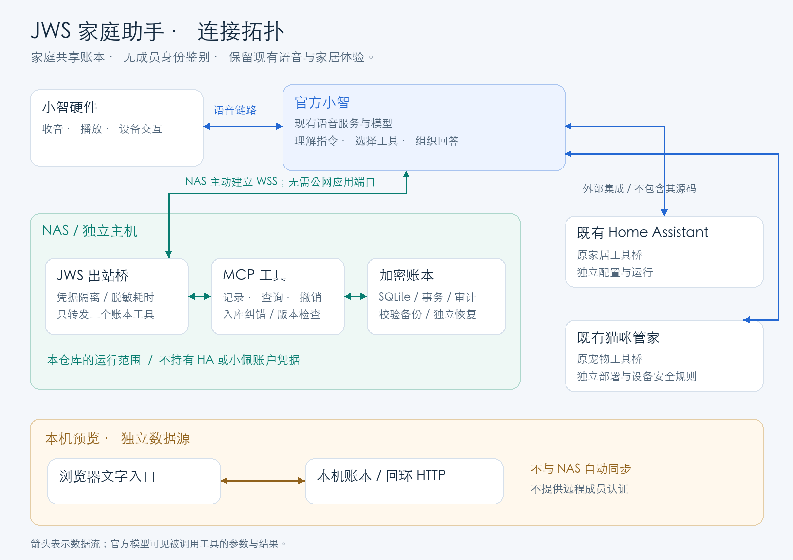
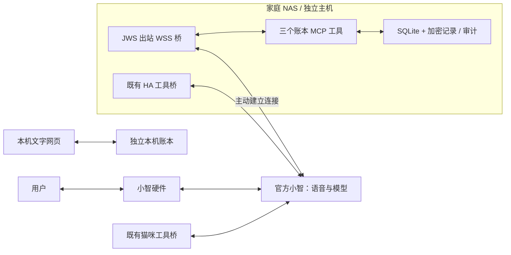
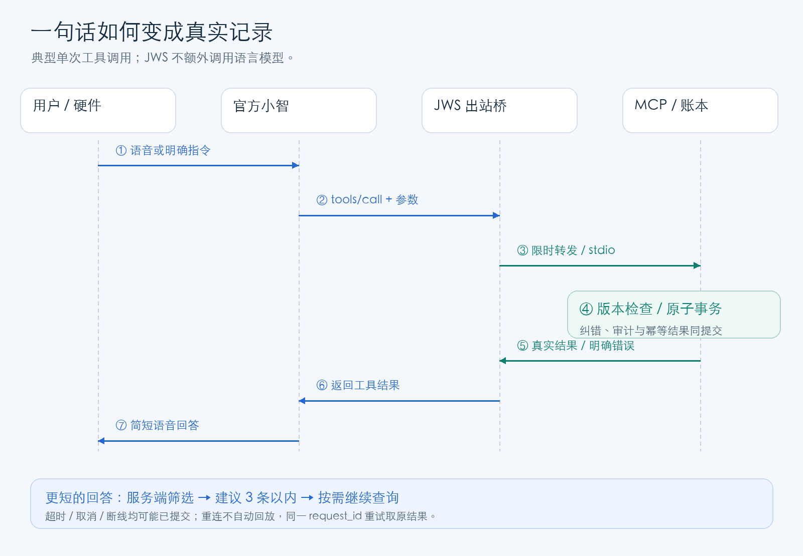

# Jarvis-household · 家庭共享账本

**让小智记住家里的物品、位置和日常开销。**

JWS 是运行在 NAS 或独立主机上的家庭账本，通过 MCP（模型上下文协议）接入官方小智。保留已有模型与音色，用三个工具完成记录、查询和撤销；已有 Home Assistant 与猫咪管家继续通过各自的工具桥工作。

> 当前版本 **0.3.0 开源预览版**，采用 [MIT 许可证](LICENSE)。面向小智的家庭共享账本、物品管理与 MCP 工具桥，可在 NAS 或独立主机部署。



## 能做什么

| 能力 | 当前实现 | 边界 |
| --- | --- | --- |
| 物品入库 | 名称、数量、单位、存放位置、入库日期、用户给出的到期日 | 缺少必要字段不写入；同名批次分别保存 |
| 查找物品 | 名称与位置筛选、余量、记录编号和版本 | 记录的位置不代表物品此刻的实际位置 |
| 到期日查询 | 今天、已超期、未来 N 天、未填日期；按日期排序 | 日期以北京时间计算，不推断食品安全 |
| 日常记账 | 支出、收入、转账、退款，月度净支出和分类汇总 | 金额以分存储；未实现预算、个人账隔离或退款关联 |
| 修改与取用 | 名称、位置、到期日、绝对余量纠错；同单位扣减；费用金额修改 | 需要唯一记录及正确版本；不能超量扣减 |
| 撤销与审计 | 原子事务、幂等请求、补偿撤销、加密操作记录 | 只能撤销账本，不撤回设备的物理动作 |
| 本机网页 | 文字快捷入口与账本预览，绑定回环地址 | 不提供语音、远程认证或与另一台 NAS 的同步 |

### 对小智这样说

- “在家庭账本入库两盒牛奶，放在冰箱冷藏上层，到期日是 2026 年 12 月 20 日。”
- “牛奶放在哪里，还剩多少？”
- “未来七天有哪些物品到期？”
- “午饭花了 38 元，用微信付的，记到家庭账本。”
- “这个月家庭账本花了多少钱？”
- “撤销刚才那笔家庭账本记录。”

上面是语音使用示例，不是自动执行脚本。语义由官方小智解释，后端负责验证、确定性计算与存储。缺少信息时需要补充，查询无记录时不能用模型知识补造库存。

## 架构与范围



本仓库包含 **JWS 账本、MCP 工具、官方接入桥、本机网页和通用部署示例**。不包含小智固件、官方语音服务、Home Assistant 自定义集成或小佩控制后端；这些是现有的外部集成，不会随 JWS 部署被安装或修改。



详情见[架构与连接边界](docs/guides/architecture.md)、[工具接口](docs/guides/tools.md)和[数据模型](docs/guides/data-model.md)。

## 本机快速开始

已验证范围与待验收平台见[验收说明](docs/guides/verification.md)。从仓库根目录使用 Python 3.12 开始：

```sh
python3.12 -m venv .venv
.venv/bin/python -m pip install -c requirements.lock .
# 无凭据、无真实数据的安装/MCP/备份/恢复验收
.venv/bin/jarvis-home-check
# 可选：以独立目录打开本机网页
JWS_DATA_DIR="$HOME/.local/share/jws-preview/ledger" .venv/bin/jarvis-home
```

打开 <http://127.0.0.1:18600/>，上例数据位于用户主目录下独立的 `.local/share/jws-preview/ledger`，属于需长期保护的账本；不设置环境变量时才使用 `.runtime/`。本机网页支持有限快捷语法，例如：

```text
买了三个番茄、一盒牛奶，花了15元
午饭38，微信
护照放在书房第二个抽屉
护照在哪
这个月花了多少
撤销
```

本机文字路由不调用模型；未完整识别的指令加密保存为草稿，不会部分写入，也不会自动重试。**网页快捷语法与官方语音不是同一条解析链路**：精准到期筛选与结构化纠错通过 MCP 提供。本机与 NAS 使用不同目录时就是两个独立账本。

## NAS / Docker 部署

先无凭据验证容器（独占测试卷、禁用网络，退出时仅清理该测试卷）：

```sh
sh scripts/test_container.sh
```

新部署示例使用独立项目名，不开放应用端口，也不挂载 Docker socket：

```sh
docker compose -f deploy/community/compose.yaml build
# 交互输入官方小智 MCP 接入点；不要把它写入 Compose 或命令参数。
docker compose -f deploy/community/compose.yaml run --rm household jarvis-home-configure
docker compose -f deploy/community/compose.yaml up -d
docker compose -f deploy/community/compose.yaml logs --tail 20 household
```

`connected` 表示连接建立，`ready` 表示 MCP 初始化成功；还需在官方控制台确认工具列表并完成真实语音验收。已有部署不要直接套用新项目名，否则会得到一个新数据卷。升级、数据卷、资源限制和回滚步骤见[部署指南](docs/guides/deployment.md)。

## 数据与隐私

- SQLite 中的业务记录、原始输入、审计前后值使用 AES-GCM 加密；记录 ID、顺序和请求摘要不属于整库加密。
- 数据库与密钥在同机。加密不能抵御持有该主机账户权限的访问者；备份必须同时保存两者。
- 语音调用会把请求参数与返回结果交给官方小智及其模型。数据库存储加密不等于模型看不到工具结果。
- 当前没有成员或声纹鉴权。能使用同一智能体的人可能访问账本；不适合需要个人账隔离的场景。
- 本机网页只绑定 `127.0.0.1`，有 Host、Origin、CSRF 检查，但不是带身份认证的远程产品。

详见[安全边界](SECURITY.md)、[备份与恢复](docs/guides/operations.md)。

## 开发与验证

```sh
.venv/bin/python -m pip install -r requirements.lock -e '.[dev]'
.venv/bin/python -m pytest -q
.venv/bin/ruff check src tests scripts
.venv/bin/python -m compileall -q src
.venv/bin/python -m pip check
.venv/bin/python -m build
.venv/bin/python scripts/verify_dist.py dist
python3 scripts/check_repository.py
```

测试使用临时数据库，不连接真实小智账号或家居设备。CI 执行测试、构建、仓库检查与容器构建；**不会发布软件包、部署 NAS 或执行设备动作**。

每次 PR 的 CI 分别验证 Python 3.12/3.13、实际 wheel/sdist、依赖漏洞、容器权限与恢复。0.3.0 已完成一次 Linux x86_64 NAS 部署和真实小智入库、纠错、撤销验收，见[脱敏验收报告](docs/guides/nas-voice-acceptance.md)；CI 不代表完整语音链路。详见[验收与语音脚本](docs/guides/verification.md)、[性能基准](docs/guides/performance.md)和[版本交付流程](docs/guides/releases.md)。

## 目录导航

```text
src/jarvis_home/       账本、工具桥与本机网页
  store.py            加密记录、事务、幂等、撤销
  models.py           字段验证与北京时间
  inventory.py        物品过滤与到期计算
  mcp.py              三个工具及参数说明
  bridge.py           官方 WSS ↔ stdio 转发
  backup.py           一致性备份
  router.py / web.py   本机有限文字语法与 HTTP 入口
tests/                业务、安全边界与 MCP 回归测试
deploy/community/     可从源码构建的通用容器示例
docs/guides/          架构、工具、运维、验收与路线
scripts/              仓库检查与图片生成
.github/              CI、Issue 模板与 PR 模板
```

## 路线与贡献

下一阶段：草稿补全与备份运维；成员身份、主动提醒和跨模块调度另行设计，不属于本预览版。完整范围见[路线图](docs/guides/roadmap.md)。

提交变更前请阅读 [CONTRIBUTING.md](CONTRIBUTING.md)。许可证、依赖许可清单和公开发布检查见[开源准备清单](docs/guides/open-source-readiness.md)。代码按 MIT 授权；尚未发布公共软件包或容器镜像。

相关项目：[小智 ESP32 固件](https://github.com/78/xiaozhi-esp32)、[官方 MCP 示例](https://github.com/78/mcp-calculator)、[Home Assistant](https://www.home-assistant.io/)。它们是独立项目，JWS 不代表其官方立场。
