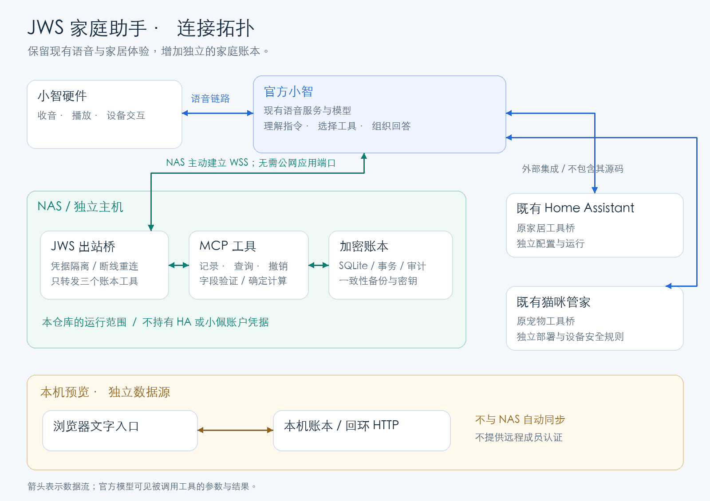
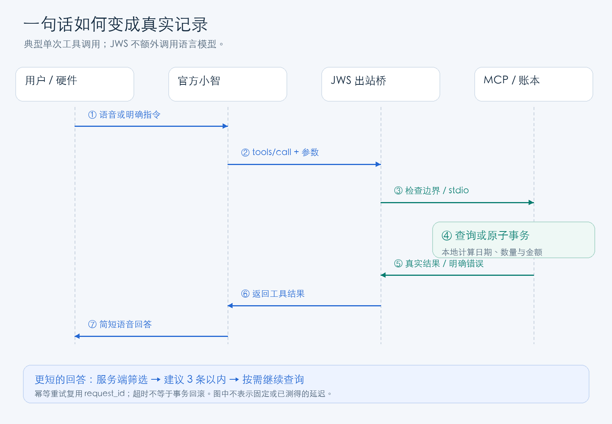
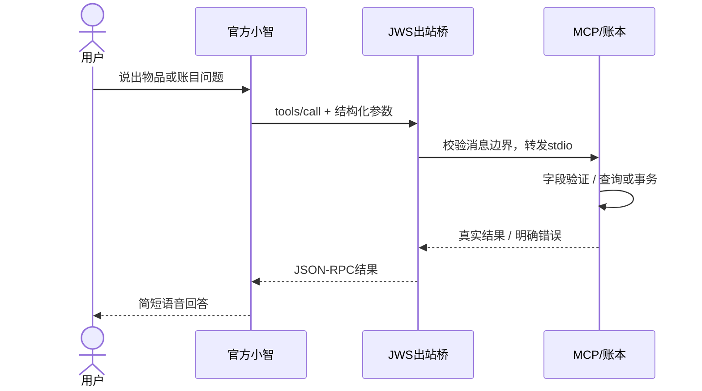

# 架构与连接边界

## 三个独立层次

1. **语音与模型**：小智硬件与官方服务处理收音、识别、对话和语音播放。本项目不替换这条链路，不在NAS运行第二个语言模型。
2. **家庭工具**：JWS、Home Assistant、猫咪管家各自提供工具。JWS只提供三个账本工具，不转发设备控制，也不持有HA或小佩账户凭据。
3. **确定性账本**：字段验证、库存与金额计算、到期日期、事务、加密、审计和撤销都在JWS进程内完成。

箭头表示双向数据流，不表示公网入站端口。JWS主动向官方域名建立TLS WebSocket连接，官方通过现有连接发送JSON-RPC请求。容器内桥接进程通过stdin/stdout与MCP子进程通信。

## 请求经过什么

查询按需选择 `scope=items` 或 `expenses`，不必先拉取全部账本。物品支持name/location子串过滤；语音建议limit=3，最多30条。到期差值由后端计算，避免模型再次推算日期。

模型可能按任务发起多次工具调用，图只表示典型单次调用。服务端快速完成查询不代表真人说完到听见答案的总延迟；ASR、模型、网络和TTS仍在外部链路。

## 连接限制

| 项目 | 实现 |
| --- | --- |
| 目的地 | `wss://api.xiaozhi.me/mcp/`，单一token参数 |
| 工具白名单 | household_query / household_record / household_undo |
| 消息上限 | 262144字节 |
| 同时待响应请求 | 最多16个 |
| 工具请求期限 | 20秒，超时结束连接 |
| 连接建立 / 发送 | 建连10秒；写入/发送5秒 |
| 心跳 | 每20秒，等待20秒 |
| 重连 | 指数退避至60秒加随机抖动，不回放请求 |
| 凭据/TLS/协议错误 | 停止连接，等待人工处理 |

`ready`仅表示成功发送初始化响应。它不证明工具语义、官方路由或真实语音验收完成。

## 数据边界

- NAS默认 `/data/ledger`；官方接入点为独立的 `/data/endpoint`。
- 本机网页默认 `.runtime`，与另一台NAS的账本没有同步协议。
- 数据库只处理账本；不会为出粮、清理、开灯等动作建立伪造的全局事务。
- 设备控制桥是外部依赖，本仓库不会部署、重启、升级它们。

## 源码对应

`bridge.py`是传输层，`mcp.py`是工具契约，`inventory.py`是查询计算，`models.py`定义数据约束，`store.py`维护业务事务，`backup.py`生成一致性备份。网页通过`router.py`调用同一Store，但其有限文字语法不等同于官方模型的语义解析。

参考：[官方小智MCP示例](https://github.com/78/mcp-calculator)、[小智固件仓库](https://github.com/78/xiaozhi-esp32)。JWS只参考协议接入方式，不打包这些项目的源码。
