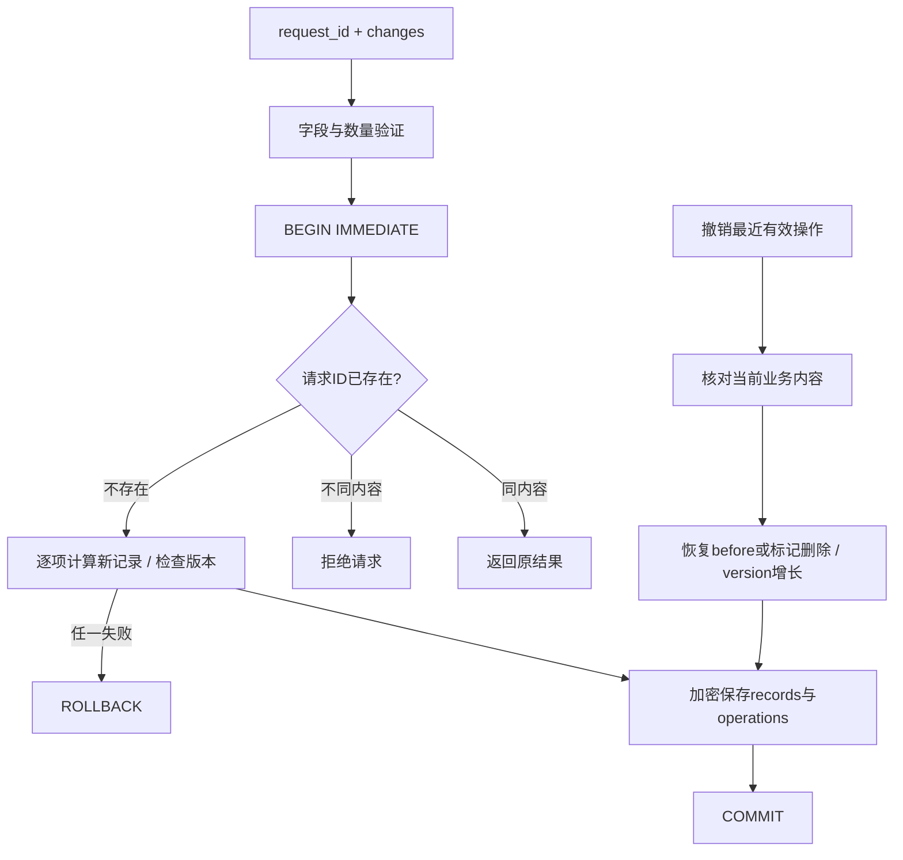

# 数据模型与兼容性

当前SQLite `user_version=1`，0.2.1只添加查询能力，没有迁移既有记录。初始化仅接受版本0/1；更高版本会拒绝打开，而不是自动覆盖。

## 三张表

| 表 | 明文索引 | 加密内容 |
| --- | --- | --- |
| records | id | 物品或费用记录 |
| operations | seq、id、digest | 原始输入、before/after、结果、撤销关联、时间 |
| meta | id | key-check密钥校验 |

每个payload使用随机12字节nonce与AES-GCM，AAD绑定表语义与记录ID；交换密文到另一记录不能通过校验。操作摘要由密钥参与HMAC计算。业务内容并非明文索引，但表名、数量、操作顺序仍可见。

## 业务字段

共同字段：id、name、version、on、deleted。

物品：type=item、quantity（十进制字符串）、unit、location、due（日期或null）、due_source（user/unset）。数量最多三位小数，取用必须同单位。用尽的物品逻辑删除，审计保留。

账目：type=expense、cents（整数）、kind、category、payment。净支出=支出-退款；收入、转账单列。金额输入最多两位小数，避免二进制浮点误差。

## 写入与撤销

撤销通过补偿记录实现，不删除原审计。当前业务内容与待撤销操作的after不一致时，不覆盖后来的修改。版本在补偿时递增；比较业务内容时排除version，以支持连续撤销。

## 草稿与保留

本机无法完整解析的文字保留为加密草稿，不写records。草稿没有自动重试或补全流程。`history()`目前返回最近30条；网页草稿计数基于这批历史，不是全量未处理草稿统计。

当前不提供永久清除、到期自动删除、密钥轮换、成员ID或独立个人账。新增字段时优先兼容旧记录，并编写旧库读取、重启、备份恢复与撤销测试。
