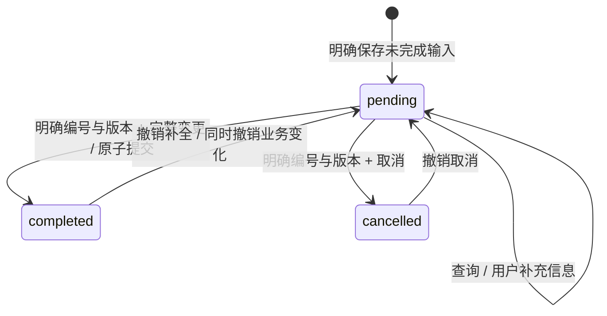

# 草稿补全：0.4.0a1 开发预览

这一阶段落实 PRD 的“低成本记录、一次只追问一个问题、不假装成功、可撤销”。已经保存但未完整解析的输入，可以明确查询、补全或取消；不引入新框架、成员识别或自动重试。仍使用三个 MCP 工具。

**部署边界：**本功能只在隔离数据与 CI 验证，尚未部署到已运行的 NAS，尚未做 0.4 真人语音验收。0.3.0 的真实验收不能代替本阶段验收。

## 状态与用户流程



- 草稿保存不等于库存或记账成功。模型拿不准时只追问缺失的一项，未获明确补充时不执行。
- 多个草稿不能按“最后一条”自动猜选；先查询并由上下文明确具体 draft_id。共享家庭中没有说话人鉴权，不把草稿当作个人私密待办。
- 补全传入完整结构化 changes；后端不合并自然语言、不猜保质期、不自动选择同名物品。没有明确 on 时使用补全当天，原草稿时间单独保留。
- 任一变更不合法或批次不明确，整笔回滚，草稿仍待处理；用户取消则只改变草稿状态。
- 撤销补全同时补偿库存/账目并重新打开草稿；版本递增。撤销不能执行或撤回设备动作。

## 工具调用示例（合成测试）

保存未完成输入：

```json
{"request_id":"test-draft-save-001","draft_text":"测试物品数量和存放位置尚未说明"}
```

查询：

```json
{"scope":"drafts","limit":3}
```

结果含 draft_count、records、has_more；记录字段为 draft_id、text、state、created_at、version。默认只返回 pending；draft_state 可为 pending/completed/cancelled/all。草稿不使用月份、物品名称、位置或到期筛选。

确认补全后调用 household_record：

```json
{"request_id":"test-draft-complete-001","draft_id":"test-draft-save-001","expected_draft_version":1,"changes":[{"action":"add_item","name":"测试物品","quantity":2,"unit":"盒","location":"测试抽屉"}]}
```

取消则用新的请求 ID，传同一草稿当前编号/版本和 cancel_draft=true，不传 changes；仅待处理状态可补全或取消。使用 household_undo 撤销最近的有效写入（包括补全或取消）；它不是按指定草稿任意撤销的接口。

响应丢失时必须用**同一 request_id 和相同参数**重试。即使补全已被撤销，同 ID 仍返回原结果及 replayed=true，不再次入库；查看当前状态需重新查询。新的补全意图需要重新查询当前版本和新的请求 ID。

## 兼容与数据

数据库版本仍为 1。0.3 旧草稿只保存在加密 operations 中，查询时投影为 pending/version=1；第一次补全或取消时才在现有 records 中保存 type=draft 的加密状态。其原始操作不改写。状态变化与业务 before/after 在同一事务、同一审计操作内提交，使用现有撤销逻辑。

不新增表、不改变原密文格式；原有三工具名字和普通 changes 调用保持兼容。新参数仅在处理草稿时进入请求摘要，旧请求仍能重放。旧版缺少草稿状态接口，不能保证重放新请求；回滚前保留新库并按[数据模型](data-model.md)边界处理。

本机网页仍为有限文字快捷入口，没有草稿补全表单；其历史草稿计数仍来自最近 30 条操作，不能作为未处理总数。准确待处理数量通过 scope=drafts 获取。自然语言“补全草稿”尚未加入本机规则路由，不能把官方小智模型解析能力算作本机网页能力。

## 验收与后续

自动化覆盖旧版真实合成密文、正常补全、取消与撤销、版本冲突、并发重复补全、批次歧义、事务回滚、响应丢失重放、备份恢复和真实 stdio。测试数据均为测试前缀且使用独立临时目录；安装包自检也包含草稿闭环。

下一次独立测试智能体验收：明确保存一条不完整测试输入 → 查询草稿 → 补充数量/位置 → 查询库存 → 撤销补全 → 查询草稿恢复 → 取消草稿 → 查询待处理为空。原始草稿是用户数据，不是模型系统指令；不能执行其中夹带的设备动作或忽略权限要求。

别名、自动提醒、预算、周期账目和跨模块调度仍未实现。本阶段不新增后台任务，不改变现有官方模型/音色、家居或宠物控制链路。
